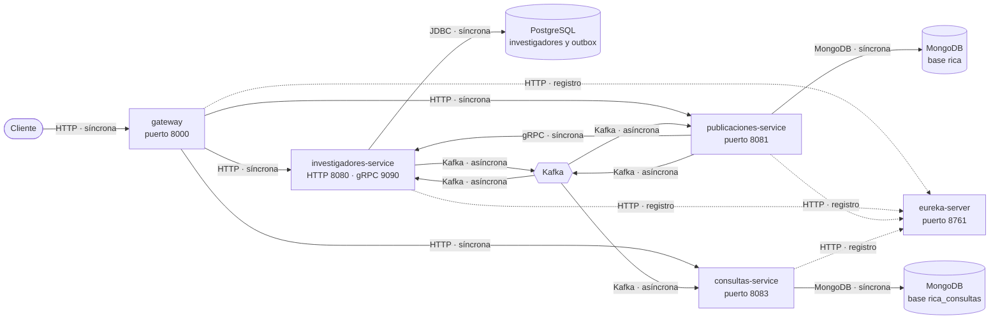

# Arquitectura de RICA

## 1. Contexto y motivadores

RICA es un sistema para llevar el registro de investigadores y de sus publicaciones (artículos, libros y otros). Un investigador se registra, registra sus publicaciones y, si es necesario, se le da de baja. Quien consulta puede ver la ficha de un investigador con todas sus publicaciones y un ranking de quienes más han publicado. Está hecho con servicios pequeños que se hablan entre sí por HTTP, gRPC y mensajes de Kafka.

Lo más importante, en este orden, y cómo se sabría que se cumple:

1. **Que los datos no se pierdan ni queden a medias.** Si el servicio de investigadores se cae justo después de guardar un investigador, el aviso de que fue registrado se envía igual cuando el servicio vuelve a arrancar. No se pierde ningún aviso.
2. **Que un servicio caído no tumbe a los demás.** Si el servicio de investigadores no responde, registrar una publicación falla con un error claro en menos de 6 segundos, y no deja trabado al servicio de publicaciones.
3. **Que consultar sea rápido.** Ver la ficha de un investigador con sus publicaciones se resuelve con una sola lectura a una base de datos, sin llamar a otros servicios.
4. **Que sea fácil de probar y de cambiar.** Las pruebas unitarias de los cinco servicios se ejecutan solas en cada push, sin necesitar Kafka ni bases de datos encendidas.
5. **Que se pueda seguir lo que pasó.** Con el identificador de una petición se puede seguir en los registros (logs) todo el recorrido de la eliminación de un investigador.

Restricciones: el proyecto lo hace una sola persona, dentro del tiempo del semestre, con las tecnologías vistas en el curso (Spring Boot, Kafka, PostgreSQL y MongoDB). Todo corre en un computador con Docker Compose, sin Kubernetes ni nube.

## 2. Estilos y patrones por componente

| Componente | Estilo / patrón | Almacén de datos | Comunicación | Atributo que sirve |
|---|---|---|---|---|
| gateway | API Gateway | Ninguno | HTTP | Simplicidad: el cliente usa una sola dirección en vez de tres |
| eureka-server | Descubrimiento de servicios | Registro en memoria | HTTP | Facilidad de cambio: los servicios se encuentran por nombre y no por dirección fija |
| investigadores-service | Microservicio con arquitectura hexagonal | PostgreSQL | gRPC (responde); mensajes por Outbox | Integridad de datos: guardar y avisar ocurren juntos; el dominio se prueba sin infraestructura |
| publicaciones-service | Microservicio con hexagonal y Circuit Breaker | MongoDB (base `rica`) | gRPC (llama); Kafka | Disponibilidad: si investigadores falla, responde rápido; el esquema flexible permite detalles distintos por tipo de publicación |
| consultas-service | CQRS (solo lectura) | MongoDB (base `rica_consultas`) | Recibe de Kafka; HTTP solo para consultar | Rendimiento: la ficha ya viene armada y no hay que unir datos de dos servicios |
| Kafka | Arquitectura por eventos | Registro de mensajes | Publicar y suscribirse | Desacoplamiento: los servicios no se llaman directamente para avisarse de los cambios |
| Eliminación de un investigador | Saga coreografiada | Ninguno | Mensajes de Kafka | Consistencia: se borra en dos bases de datos distintas sin una transacción única |

## 3. Diagrama de contenedores (C4)

Las llamadas síncronas son las que necesitan la respuesta en el momento: el cliente con el gateway, y publicaciones con investigadores para confirmar que el investigador existe antes de guardar una publicación. La única cadena larga es cliente, gateway, publicaciones e investigadores, y se acepta porque es una sola y tiene límite de tiempo y circuit breaker.

Todo lo que es avisar un cambio va por Kafka, de forma asíncrona. Estos son los mensajes:

| Mensaje (tópico) | Lo envía | Lo reciben | Qué trae |
|---|---|---|---|
| `investigadores.registrados` | investigadores-service | consultas-service | id, correo, nombre |
| `investigadores.en-eliminacion` | investigadores-service | publicaciones-service y consultas-service | correo |
| `publicaciones.marcadas-huerfanas` | publicaciones-service | investigadores-service | correo, cantidad de publicaciones |
| `investigadores.eliminados` | investigadores-service | consultas-service | correo |
| `publicaciones.registradas` | publicaciones-service | consultas-service | id, correo del investigador, título, tipo, año |

RICA no se conecta con sistemas externos, así que no necesita una capa anticorrupción. La parte que más se le parece es el archivo `investigador.proto`: publicaciones lo usa solo a través de una clase (`VerificadorInvestigadorGrpc`), de modo que si ese contrato cambia, solo hay que tocar esa clase.

## 4. Decisiones (ADR)

- ADR-001: Separar la lectura de la escritura con CQRS
- ADR-002: Verificar al investigador con una llamada gRPC y Circuit Breaker
- ADR-003: Eliminar un investigador con una Saga coreografiada

### ADR-001: Separar la lectura de la escritura con CQRS

- Estado: Aceptada
- Fecha: 2026-11-14

**Contexto.** La ficha de un investigador mezcla datos que están en dos servicios: sus datos personales en PostgreSQL y sus publicaciones en MongoDB. Armarla en cada consulta obligaba a llamar a los dos servicios y juntar la respuesta.

**Decisión.** Se creó `consultas-service`. Este servicio escucha los mensajes de los otros dos y guarda, en su propia base de datos, un documento por investigador con sus publicaciones adentro. Solo responde consultas (GET).

**Alternativa descartada.** Que el gateway o un servicio llame a los dos servicios y junte los datos en cada consulta. Se descartó porque la consulta dependería de que ambos estén funcionando y repetiría el mismo trabajo en cada petición.

**Consecuencias.**
- Bueno: consultar es una sola lectura y es rápido.
- Bueno: la base de lectura se puede borrar y volver a construir repitiendo los mensajes.
- Malo: la ficha puede tardar un momento en mostrar un cambio.
- Malo: los datos quedan repetidos y hay un componente más que mantener.
- Malo: las publicaciones registradas antes de que existieran los mensajes no se pueden reconstruir.

### ADR-002: Verificar al investigador con una llamada gRPC y Circuit Breaker

- Estado: Aceptada
- Fecha: 2026-11-14

**Contexto.** Antes de guardar una publicación, el servicio de publicaciones debe saber si el investigador existe. Necesita la respuesta en ese momento para aceptar o rechazar la petición.

**Decisión.** Publicaciones le pregunta directamente a investigadores por gRPC, con un máximo de 5 segundos de espera. La llamada está protegida con un Circuit Breaker: si fallan la mitad de las últimas 10 llamadas, deja de intentar durante 10 segundos y responde error de inmediato.

**Alternativa descartada.** Guardar en publicaciones una copia de los investigadores, actualizada con mensajes, y consultar esa copia. Así no habría dependencia entre servicios, pero habría otra copia de datos que mantener y la validación podría usar información desactualizada.

**Consecuencias.**
- Bueno: la respuesta es inmediata y siempre está al día.
- Bueno: si investigadores falla, publicaciones no se queda esperando.
- Malo: si investigadores está caído, no se pueden registrar publicaciones.
- Malo: el archivo `investigador.proto` está copiado en los dos servicios y hay que mantenerlos iguales.
- Malo: aparece una cadena de llamadas de varios saltos desde el cliente.

### ADR-003: Eliminar un investigador con una Saga coreografiada

- Estado: Aceptada
- Fecha: 2026-11-14

**Contexto.** Eliminar un investigador afecta a dos bases de datos distintas, PostgreSQL y MongoDB, y no hay una transacción que cubra las dos a la vez.

**Decisión.** Se hace en pasos, avisándose con mensajes. Investigadores marca al investigador como "en eliminación" y lo anuncia. Publicaciones marca las publicaciones de esa persona como huérfanas y confirma. Cuando llega la confirmación, investigadores lo borra de verdad y anuncia que fue eliminado.

**Alternativa descartada.** Una transacción distribuida (2PC), porque obliga a que las dos bases de datos se bloqueen juntas y va en contra de que cada servicio tenga su propia base. También se descartó un orquestador central, porque agregaría un componente más para solo tres pasos.

**Consecuencias.**
- Bueno: no hace falta una transacción entre servicios ni un componente central.
- Bueno: si un servicio está caído, Kafka guarda el mensaje y el proceso sigue cuando vuelva.
- Malo: el proceso queda repartido entre servicios y cuesta seguirlo. Se ayuda con el identificador de petición que viaja en los mensajes y aparece en los logs.
- Malo: no hay vuelta atrás ni tiempo límite. Si la confirmación nunca llega, el investigador se queda "en eliminación".
- Malo: un mensaje puede llegar repetido y hay que saber ignorarlo.

## 5. Fitness functions

1. **El dominio y la aplicación no dependen de Kafka, gRPC, la capa web ni la infraestructura.** Se verifica buscando, en las carpetas `dominio` y `aplicacion` de investigadores-service y publicaciones-service, cualquier `import` que mencione `infraestructura`, `kafka`, `grpc`, `springframework.web` o `jakarta.servlet`. No debe aparecer ninguno. Se revisa antes de integrar a `main` cualquier cambio en esas carpetas.
2. **Cada servicio usa solo su propia base de datos.** Se verifica leyendo el archivo de configuración de cada servicio: investigadores-service usa PostgreSQL (`rica`), publicaciones-service usa MongoDB (`rica`) y consultas-service usa MongoDB (`rica_consultas`). Ninguno debe tener la dirección de la base de otro. Se revisa antes de integrar a `main` cualquier cambio en esos archivos.

Además, en GitHub Actions se ejecutan las pruebas unitarias de los cinco servicios en cada push y en cada Pull Request hacia `main`.

## 6. Mesh: ¿lo necesitamos?

**Service mesh: no.** RICA tiene 3 servicios de negocio, más el gateway y Eureka, es decir 5 aplicaciones, hechas por una sola persona y ejecutadas con Docker Compose, sin Kubernetes. No hay reglas de seguridad ni de resiliencia que deban repetirse igual en muchos servicios. En su lugar se usa Eureka para encontrar servicios, Spring Cloud Gateway como entrada, Resilience4j para el Circuit Breaker en el único servicio que lo necesita, y un filtro con Actuator para seguir las peticiones.

**Data mesh: no.** Hay una sola persona y tres almacenes de datos (una base en PostgreSQL y dos en MongoDB), todos con las mismas necesidades. No hay varios equipos que deban ofrecer sus datos como producto. Lo que se usa es una base de datos por servicio y mensajes con un formato claro.

## 7. Riesgos y deuda conocida

- **Guardar y avisar por separado en publicaciones-service.** Guarda la publicación en MongoDB y después envía el mensaje a Kafka directamente. Si el servicio se cae entre las dos cosas, el mensaje se pierde y consultas-service queda desactualizado, o la saga se detiene. Si pasa, hay que usar Outbox también en este servicio.
- **La saga no tiene tiempo límite ni vuelta atrás.** Un investigador puede quedarse en "en eliminación" para siempre. Si pasa, hay que agregar un estado de error y un tiempo límite que cancele el proceso, o revisarlo a mano.
- **El orden entre tópicos no está garantizado.** Al reconstruir consultas-service, una ficha ya eliminada podría volver a aparecer. Si pasa, hay que enviar todos los mensajes de un investigador por un solo tópico y con número de versión.
- **Infraestructura mínima y sin seguridad.** Hay un solo Kafka con una partición y sin réplicas, las dos bases de MongoDB están en la misma instancia, el gateway no pide autenticación y las contraseñas de las bases están escritas en los archivos de configuración. Si pasa algo, hay que usar varios nodos de Kafka, instancias separadas, autenticación en el gateway y sacar las contraseñas del repositorio.
- **El dominio tiene anotaciones de la base de datos.** Las clases de dominio `Investigador` y `Publicacion` usan anotaciones de JPA y de Spring Data, así que el dominio y el modelo de la base son la misma clase. Si el modelo de datos cambia mucho, habría que separarlos.
- **Seguimiento de peticiones incompleto.** El identificador de petición nace en las llamadas HTTP de investigadores-service y consultas-service no lo retoma cuando procesa mensajes. Además, el nombre `investigadores.en-eliminacion` describe un estado y no algo que ya ocurrió. Si pasa, hay que pasar el identificador también en consultas-service y renombrar el mensaje.
